  

  

    
    
    
    
  

  

    <a href="#about">ABOUT</a> &nbsp;·&nbsp;
    <a href="#featured-projects">PROJECTS</a> &nbsp;·&nbsp;
    <a href="#technology-stack">TECH STACK</a> &nbsp;·&nbsp;
    <a href="#principles">PRINCIPLES</a> &nbsp;·&nbsp;
    <a href="#documentation-standard">DOCUMENTATION</a> &nbsp;·&nbsp;
    <a href="#contact">CONTACT</a>
  

---

## About

  

I believe access to technology should not depend on your budget, your school or where you come from.

I build practical software, experiment with infrastructure and document what I learn. The aim is to make useful tools easier to find, understand, reproduce and maintain.

**My mission is to make free technology easier to use.**

## Featured Projects

A selection of projects covering infrastructure, game development, developer tools and technical documentation.

### Infrastructure & Hosting

| Project | Description |
|:---|:---|
| [**Cloud-Project-K3s**](https://github.com/RufusTheDwarf/Cloud-Project-K3s) | A private cloud lab built with two Ubuntu Server VMs, K3s, Kubernetes and PostgreSQL. The project focuses on deployment, persistence, access control, backups and recovery. |
| [**mc-server-template**](https://github.com/RufusTheDwarf/mc-server-template) | A ready-to-use PaperMC Minecraft server template for GitHub Codespaces. |
| [**Minecraft-Server**](https://github.com/RufusTheDwarf/Minecraft-Server) | An automated PaperMC server with setup, backup and update scripts. |
| **PowerShell-SysInfo-Logger** | A private PowerShell utility for collecting local and remote system information through CIM. |

### Games & Interactive Projects

| Project | Description |
|:---|:---|
| [**Parfum Empire**](https://github.com/RufusTheDwarf/parfum-empire) | A browser-based 2D management game about building a perfume house through harvesting, formulation, production and sales. |
| [**Code_Quest**](https://github.com/RufusTheDwarf/Code_Quest) | A console RPG where players fight bugs, viruses and hackers by answering computer science questions. |
| [**Jouer-aux-anciens-jeux-Flash**](https://github.com/RufusTheDwarf/Jouer-aux-anciens-jeux-Flash) | A practical guide to playing Flash games on Windows, macOS and Linux with Ruffle. |

### Developer Tools & Security

| Project | Description |
|:---|:---|
| [**verified-by-default**](https://github.com/RufusTheDwarf/verified-by-default) | A workflow for keeping AI-assisted development compatible with trusted, verified Git commit signatures. |
| [**git-signed-commits-windows**](https://github.com/RufusTheDwarf/git-signed-commits-windows) | A step-by-step guide to signing Git commits with SSH on Windows. |
| [**CouteauSuisse**](https://github.com/RufusTheDwarf/CouteauSuisse) | A Windows console toolkit with Morse conversion, audio playback, base conversion and other utilities. |

### Web & Learning

| Project | Description |
|:---|:---|
| [**chococoa-web**](https://github.com/RufusTheDwarf/chococoa-web) | A chocolate-themed static website built to practise HTML, CSS and JavaScript. |
| [**SQL_Server_project**](https://github.com/RufusTheDwarf/SQL_Server_project) | A SQL Server project covering database design, queries, Python data generation and practical scenarios. |

## Technology Stack

  

The badges below represent technologies used across my projects.

### Languages

  

    
    
    
    
    
    
    
    
    
    
  

### Frameworks & Runtimes

  

    
    
    
    
    
  

### Infrastructure & Databases

  

    
    
    
    
    
    
    
    
  

### Development Tools

  

    
    
    
    
    
  

## Principles

| Principle | What it means in practice |
|:---|:---|
| **Actually free** | Prefer tools that do not hide essential features behind subscriptions or trials. State costs and limitations clearly. |
| **Reproducible** | Explain how to rebuild the result from a clean environment. |
| **Documented** | Explain why a step matters, not only which command to run. |
| **Honest** | Document limitations, bugs and unsuccessful approaches. |
| **Open source first** | Prefer open standards and free and open source tools whenever practical. |
| **Accessible** | Do not assume the reader already knows the technology. |

## Guides & Tutorials

Some repositories are practical guides rather than conventional software projects. They focus on making technical processes understandable from the beginning.

A guide should include official download sources, prerequisites, exact commands, expected outputs, explanations of important configuration choices and troubleshooting steps. When practical, it should also document free alternatives and the limits of the chosen approach.

**Available guides**

| Guide | Topic |
|:---|:---|
| [Play Old Flash Games](https://github.com/RufusTheDwarf/Jouer-aux-anciens-jeux-Flash) | Flash game preservation with Ruffle. |
| [Git SSH Signing on Windows](https://github.com/RufusTheDwarf/git-signed-commits-windows) | Configure Git to sign commits with an SSH key. |
| [Verified by Default](https://github.com/RufusTheDwarf/verified-by-default) | A reliable signing workflow for AI-assisted development. |
| [Minecraft Server Template](https://github.com/RufusTheDwarf/mc-server-template) | Run a Minecraft server in GitHub Codespaces. |

Have a topic in mind? [Open an issue](https://github.com/RufusTheDwarf/RufusTheDwarf/issues) and describe what you want to accomplish.

## Documentation Standard

Every technical guide should aim to meet these requirements:

1. Start from a clean machine or clearly state the required starting point.
2. List prerequisites and official download links.
3. Explain each important configuration step.
4. Provide exact commands and expected outputs.
5. Document common errors and their solutions.
6. Offer alternative methods where practical.
7. State costs, limitations and security implications.
8. Keep the instructions maintainable as tools evolve.

Documentation is part of the project, not an afterthought.

## GitHub Activity

  
  

## Contributing

Suggestions, feedback and contributions are welcome.

| Contribution | How to help |
|:---|:---|
| **Report a bug** | Open an issue with clear reproduction steps. |
| **Suggest an improvement** | Explain what could be improved and why. |
| **Request a guide** | Open an issue titled `Guide request: [topic]`. |
| **Submit a fix** | Fork the repository and open a Pull Request. |
| **Suggest a project** | Share an idea that fits the mission. |

### Pull Request Workflow

1. Fork the repository.
2. Create a branch: `git switch -c feature/my-improvement`.
3. Make and test your changes.
4. Commit your work with a clear message.
5. Push your branch and open a Pull Request.

## Contact

GitHub is the best place to reach me.

  

    
    
    
  

I keep technical discussions on GitHub so that useful answers remain searchable and accessible to others.

  
  
Designed and maintained by <strong>RufusTheDwarf</strong>

