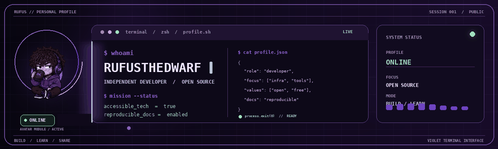
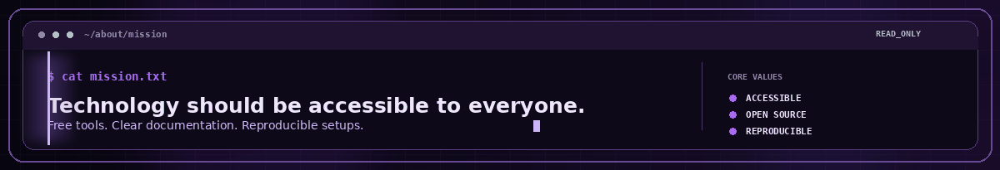
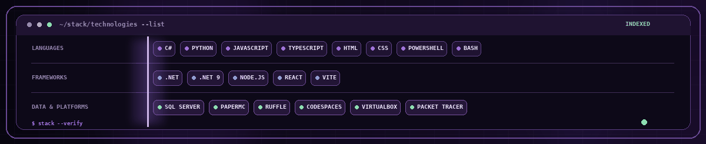
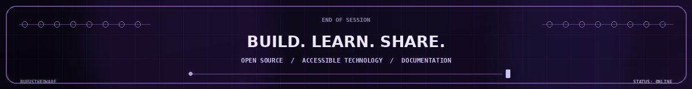

  

  

    
    
    
    
  

  

    <a href="#about">ABOUT</a> ·
    <a href="#featured-projects">PROJECTS</a> ·
    <a href="#technology-stack">SKILLS</a> ·
    <a href="#principles">PRINCIPLES</a> ·
    <a href="#documentation-standard">DOCUMENTATION</a> ·
    <a href="#contact">CONTACT</a>
  

---

## About

  

I believe access to technology should not depend on your budget, your school or where you come from.

Powerful tools already exist. Many are free, but the knowledge required to use them can be difficult to find. I build practical tools and write documentation that helps people understand, reproduce and maintain their own setups.

**My mission is to make free technology easier to find, understand and use.**

## Featured Projects

My repositories cover infrastructure, game preservation, developer utilities and web development.

### Infrastructure & Hosting

| Project | Description |
|:---|:---|
| [**mc-server-template**](https://github.com/RufusTheDwarf/mc-server-template) | A ready-to-use PaperMC Minecraft server template for GitHub Codespaces. One click, no manual setup. |
| [**Minecraft-Server**](https://github.com/RufusTheDwarf/Minecraft-Server) | An automated PaperMC server with setup, backup and update scripts. |
| **PowerShell-SysInfo-Logger** | A PowerShell utility for collecting local and remote system information through CIM. Private repository. |

### Games & Preservation

| Project | Description |
|:---|:---|
| [**Jouer-aux-anciens-jeux-Flash**](https://github.com/RufusTheDwarf/Jouer-aux-anciens-jeux-Flash) | A guide to playing Flash games on Windows, macOS and Linux using Ruffle. |
| [**Code_Quest**](https://github.com/RufusTheDwarf/Code_Quest) | A console RPG where players fight bugs, viruses and hackers by answering computer science questions. |

### Developer Tools

| Project | Description |
|:---|:---|
| [**CouteauSuisse**](https://github.com/RufusTheDwarf/CouteauSuisse) | A Windows console toolkit with Morse conversion, audio playback, base conversion and other utilities. |

### Web & Learning

| Project | Description |
|:---|:---|
| [**chococoa-web**](https://github.com/RufusTheDwarf/chococoa-web) | A chocolate-themed static website built to practise HTML, CSS and JavaScript. |
| [**SQL_Server_project**](https://github.com/RufusTheDwarf/SQL_Server_project) | A SQL Server training project covering database design, queries, Python data generation and practical scenarios. |

## Technology Stack

  

The badges below represent technologies used across my projects.

### Languages

  
  
  
  
  
  
  
  

### Frameworks & Runtimes

  
  
  
  

### Databases

  
  

### Platforms & Tools

  
  
  
  
  
  
  
  
  
  

## Principles

| Principle | What it means in practice |
|:---|:---|
| **Actually free** | No hidden paywalls or fake free trials. When a service starts charging, document the alternatives. |
| **Reproducible** | Guides start from a clean machine and list the required prerequisites. |
| **Documented** | Explain why a step matters, not only which command to run. |
| **Honest** | State limitations, bugs and unsuccessful approaches clearly. |
| **Open source first** | Prefer open standards and free and open-source tools whenever practical. |
| **Accessible** | Do not assume the reader already knows the technology. |

## Guides & Tutorials

Some repositories are practical guides rather than conventional software projects. They make a process understandable from the beginning.

A guide aims to include:

* Official download sources and prerequisites.
* Exact commands and expected outputs.
* An explanation of important configuration choices.
* Common errors and troubleshooting steps.
* Free alternatives when the primary solution is unavailable.
* Updates when tools and procedures change.

**Available guides**

* [Play Old Flash Games](https://github.com/RufusTheDwarf/Jouer-aux-anciens-jeux-Flash): Ruffle installation and Flash game preservation.
* [Minecraft Server Template](https://github.com/RufusTheDwarf/mc-server-template): Run a Minecraft server in GitHub Codespaces.

Have a topic in mind? [Open an issue](https://github.com/RufusTheDwarf/RufusTheDwarf/issues) and describe what you want to accomplish.

## Documentation Standard

Every technical guide should aim to meet these requirements.

* [x] Starts from a clean machine.
* [x] Lists prerequisites and official download links.
* [x] Explains each important configuration step.
* [x] Provides exact commands and expected outputs.
* [x] Documents common errors and their solutions.
* [x] Offers alternative methods where practical.
* [x] Avoids hidden costs.
* [x] Can be maintained as tools evolve.

Documentation is part of the project, not an afterthought.

## GitHub Activity

  
  

## Contributing

Suggestions, feedback and contributions are welcome.

| Contribution | How to help |
|:---|:---|
| **Report a bug** | Open an issue with clear reproduction steps. |
| **Suggest an improvement** | Explain what could be improved and why. |
| **Request a guide** | Open an issue titled `Guide request: [topic]`. |
| **Submit a fix** | Fork the repository and open a Pull Request. |
| **Suggest a project** | Share an idea that fits the mission. |

### Pull Request Workflow

1. Fork the repository.
2. Create a branch: `git checkout -b feature/my-improvement`.
3. Make and test your changes.
4. Commit your work with a clear message.
5. Push your branch and open a Pull Request.

## Contact

GitHub is the best place to reach me.

* [Open an issue](https://github.com/RufusTheDwarf/RufusTheDwarf/issues) for technical questions or suggestions.
* [Explore my repositories](https://github.com/RufusTheDwarf?tab=repositories) to discover my projects.
* Use GitHub Discussions for general conversations when available.

I do not publish a personal email address. Keeping technical discussions on GitHub makes useful answers searchable and accessible to others.

  
  

    
    
  

  Designed and maintained by <strong>RufusTheDwarf</strong>

