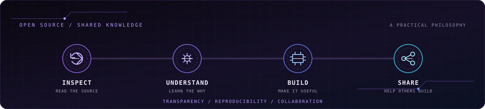

 

 

 

## About me

**Understand. Build. Learn. Share.**

I am a computer science student and independent developer interested in infrastructure, systems, networking, cybersecurity, databases and software development. I like exploring what happens behind an interface: how machines communicate, how services are deployed, how data is structured and how security mechanisms protect digital environments.

My repositories bring together practical experiments, technical guides, educational tools, automation and software projects. They are part of a hands-on learning process. Some are finished learning projects, some are still evolving, and others are early-stage experiments. I try to understand the technology behind each result, document the process and improve the implementation instead of treating a working result as the end of the job.

I am especially interested in the technical foundations of computing: operating systems, networks, services, databases, permissions, deployment and the way separate components work together. I also enjoy building applications and games because they provide concrete problems to solve, from state management and input handling to persistence, testing and user experience.

## Open source is a philosophy

I believe useful knowledge should be understandable and shareable. Publishing code is only one part of that process. A good project should explain how it works, identify its limitations, preserve authorship and use a clear license when reuse is intended.

| Principle | How I apply it |
|:--|:--|
| Inspect | Read existing code and documentation before changing things. |
| Understand | Learn why a system behaves the way it does, not only which command makes it work. |
| Build | Turn technical ideas into practical experiments, scripts and applications. |
| Share | Publish useful code, guides and lessons when possible. |
| Improve | Refine projects, correct mistakes, add missing explanations and document limitations. |
| Respect | Preserve licenses, credits, author attribution and third-party ownership. |

A public repository is not automatically open source. Reuse depends on the license and on the rights attached to included third-party material. I want the public parts of my work to be useful to other learners, while being clear about what is complete, what is experimental and what still needs improvement.

## Featured projects

### Cloud Project K3s

A private-cloud laboratory designed around two Ubuntu Server virtual machines and a K3s cluster. The repository contains Kubernetes manifests for a Helpdesk service and PostgreSQL, alongside scripts for preparing the virtual machines, installing the K3s server and agent, creating application secrets, and backing up or restoring the database.

The project is intended to explore how a small multi-node environment is assembled and operated. Its learning areas include Linux server preparation, Kubernetes resources, deployments, services, persistent data, RBAC, secret handling and basic operational procedures.

The project is still in progress. The current installer expects a `k3s-version.txt` file that is not present in the tracked tree, and the Helpdesk manifest references a locally available `helpdesk:v1` image. It should not yet be described as a turnkey deployment.

[**Explore Cloud Project K3s**](https://github.com/RufusTheDwarf/Cloud-Project-K3s)

 

### Verified by Default

A documentation-led security workflow for AI-assisted development. It explains how commits can be signed by a trusted identity, checked locally and confirmed by GitHub before being treated as verified. Its central rule is simple: no unsigned fallback and no claim of verification before GitHub confirms it.

The guide discusses signing identities, SSH and GPG, trust boundaries for local and remote agents, GitHub verification results and ways to prevent unsigned commits from being merged. It is designed to help developers reason about the trust chain instead of treating a green badge as a decorative label.

This repository currently contains its documentation and license, not a standalone application or an automated commit-signing tool.

[**Explore Verified by Default**](https://github.com/RufusTheDwarf/verified-by-default)

 

### Parfum Empire

A 2D browser-based perfume tycoon. The current TypeScript code includes material gathering, recipes, production machines, sales, customer orders, multiple worlds and floors, missions, upgrades, prestige progression, local saves and JSON import/export.

The game separates economy rules from the browser interface and workshop scene. Its visual assets include original bottles, materials, machines and the perfume emblem. The repository also contains unit tests for economy and workshop-scene behaviour, plus scripts for development, type checking, testing and production builds.

The current package manifest declares TypeScript `~5.8.3`, Vite `^6.3.5` and Vitest `^3.2.4`, with package version `0.4.0`. These are source configuration values, not a published GitHub release. The audit did not execute the test suite or production build. The application uses browser-side storage and does not provide a backend account system, cloud saves or multiplayer service.

[**Explore Parfum Empire**](https://github.com/RufusTheDwarf/parfum-empire)

## Project catalogue

The catalogue below covers the remaining repositories without repeating the three featured projects above. The status labels describe the state visible in the repositories, not a guarantee that every setup has been tested on a clean machine.

### Infrastructure and hosting

| Project | What it contains | Status and badges |
|:--|:--|:--|
| [**Docker Network Toolkit**](https://github.com/RufusTheDwarf/Docker-Network-Toolkit) | An early educational project for a Linux and Docker networking laboratory. The current tree contains starter documentation, an empty Dockerfile and script placeholders. There is no Compose file or automated test suite yet. |    |
| [**Minecraft Server**](https://github.com/RufusTheDwarf/Minecraft-Server) | A multilingual guide for hosting a private Minecraft Java server with PaperMC, GitHub Codespaces, Crafty Controller and Playit.gg. It covers the setup process, server management, networking, backups, session lifecycle and Codespaces limitations. Documentation is available in eight languages. |      |
| [**mc-server-template**](https://github.com/RufusTheDwarf/mc-server-template) | A reusable Codespaces template with a devcontainer, setup scripts, Crafty Controller, Playit.gg, server lifecycle helpers and automatic backups. It is intended as a starting point for a personal Minecraft server environment. |     |

> [!WARNING]
> `mc-server-template/config/default.json` contains a fixed initial Crafty administrator password. Treat it as exposed, replace it before use and rotate any credentials created from that default. The value is intentionally not reproduced here.

The Minecraft projects provide practical exposure to server hosting, Java runtime requirements, remote access, server panels, configuration files, persistent worlds and backup procedures. The guide and template have different purposes: one explains the process, while the other provides a reusable starting structure.

### Security and developer tools

| Project | What it contains | Status and badges |
|:--|:--|:--|
| [**git-signed-commits-windows**](https://github.com/RufusTheDwarf/git-signed-commits-windows) | A beginner-friendly Windows guide to configuring SSH commit signing. It walks through creating a dedicated key, configuring Git, creating an `allowed_signers` file, registering the public key on GitHub and checking the Verified status. |     |
| **git-ssh-signing-setup**  | A private PowerShell companion project for configuring SSH commit signing on Windows. The private repository is not linked publicly. |    |

These two projects approach the same topic from different angles: one focuses on explaining the workflow, while the private companion automates parts of the local setup. The broader learning areas include public-key cryptography, key separation, local trust configuration, Git's signing settings and GitHub's verification model.

### Software and games

| Project | What it contains | Status and badges |
|:--|:--|:--|
| [**CouteauSuisse**](https://github.com/RufusTheDwarf/CouteauSuisse) | A French Windows console toolbox with Morse conversion and audio, decimal, binary and octal conversions, and text steganography using invisible Unicode characters. Steganography hides data in text; it is not encryption. |     |
| [**Code Quest**](https://github.com/RufusTheDwarf/Code_Quest) | A Windows console RPG that turns computer science and cybersecurity questions into combat, progression and four difficulty tiers. The source includes question banks, enemies, power-ups, rendering components, screens and game-session services. |      |

`Code_Quest.csproj` currently identifies the source version as `2.0.0`, while the published GitHub release is `v1.0`. These are different version references and should not be treated as the same release.

### Data, web and digital preservation

| Project | What it contains | Status and badges |
|:--|:--|:--|
| [**SQL Server Project**](https://github.com/RufusTheDwarf/SQL_Server_project) | A database learning repository containing T-SQL material, Python data-generation scripts, project manuals and archived ETML documents. The current root README and `setup.ps1` target `version-finale/mission-sql-cinema`, a directory absent from the tracked tree. The current files therefore do not support the README's claim that this Flask application is available at that path. |     |
| [**Chococoa Web**](https://github.com/RufusTheDwarf/chococoa-web) | A multi-page chocolate-themed static website built with HTML, CSS and vanilla JavaScript. Its pages cover a boutique, information, news, a quiz, VIP content, newsletter and contact sections. The tree includes separate CSS and JavaScript files for shared layout behaviour and quiz interactions. |     |
| [**Play Old Flash Games**](https://github.com/RufusTheDwarf/Play-old-Flash-games) | A digital preservation archive containing Road of Fury SWF files, original game screenshots, Internet Archive metadata and the Ruffle desktop emulator files. The README documents ways to open archived SWF content and explains preservation and redistribution limitations. |     |

Flash Archive. Original archived game screenshot.

  

Chococoa Web. Original project assets.

The SQL repository is currently best understood as a collection of database coursework, scripts and archived project material until its declared active application path is restored or updated. Chococoa demonstrates multi-page frontend structure and small interactive JavaScript modules. Flash Archive explores how older browser content can be preserved while respecting the original rights attached to games and other assets.

## Technology stack

### Languages and development

### Infrastructure and data

 

The icon strips provide a quick visual overview. The badges below them give the technologies names and link to their official documentation or project pages. They are intentionally kept as separate elements: icons do not replace badges.

## What these projects teach

The repositories cover different layers of computing. Some focus on code, some on systems and some on the process of documenting or preserving technical work.

| Area | Concepts explored through the repositories | Related projects |
|:--|:--|:--|
| Infrastructure | Linux administration, virtual machines, network layouts, Kubernetes manifests, K3s, service deployment, persistent data and backup workflows. | Cloud Project K3s, Docker Network Toolkit, Minecraft Server |
| Security | SSH commit signing, Ed25519 keys, `allowed_signers`, Windows file permissions, trust boundaries and GitHub signature verification. | Verified by Default, git-signed-commits-windows, git-ssh-signing-setup |
| Databases | T-SQL, relational database material, Python data generation, data volume and documentation of database exercises. | SQL Server Project |
| Development | C# with .NET 8 and .NET 9, TypeScript, JavaScript, static web development, testing and application structure. | CouteauSuisse, Code Quest, Parfum Empire, Chococoa Web |
| Game systems | State management, progression, economy rules, Canvas 2D rendering, input handling, game data and local persistence. | Code Quest, Parfum Empire |
| Hosting | Server setup, Java runtimes, remote access, configuration files, server panels, world persistence and backups. | Minecraft Server, mc-server-template |
| Preservation | SWF archives, emulator-based access, metadata, screenshots and third-party content rights. | Play Old Flash Games |
| Technical communication | Setup guides, reproducible instructions, troubleshooting notes, project reports and contribution guidance. | Minecraft Server, git-signed-commits-windows, SQL Server Project |

### Learning through practical work

My approach is to start with a concrete question and investigate the system behind it. When a server does not start, for example, the useful lesson is not only which command fixes it. It is also understanding the service, its configuration, permissions, logs, dependencies and network access.

The same idea applies to development. A feature is more valuable as a learning exercise when I can explain its state, inputs, outputs, limitations and failure cases. That is why documentation, tests and reproducible setup instructions matter alongside the implementation.

I want to keep building across these areas while strengthening the fundamentals: how operating systems manage processes and files, how networks carry traffic, how applications store data, and how security establishes identity and trust.

## Project quality and current limitations

Not every repository is intended to be a polished product. The collection includes guides, school projects, experiments, reusable templates and unfinished scaffolds. The labels and descriptions above are meant to make those differences visible.

A few limitations are worth calling out explicitly:

- The SQL Server Project root setup currently points to a directory that is not present in the tracked repository tree. Its declared application workflow needs its folder layout reconciled before it can be presented as reproducible.
- The Cloud Project K3s installation script expects a version file that is not tracked, and its Helpdesk deployment references an image that must be available locally.
- The Docker Network Toolkit is an early scaffold. Its current repository does not yet provide a complete Compose deployment.
- The Minecraft template contains a fixed initial administrator password in its configuration. It must be replaced before use.
- The Chococoa Web repository has no detected license file. Public visibility alone does not grant reuse permissions.
- The Flash Archive repository's CC0 license does not override the rights of third-party game files and assets.

I prefer to document these boundaries instead of describing every repository as finished or production-ready.

## Licenses and reuse

The license files currently detected across the 13 project repositories are:

| License | Repositories |
|:--|:--|
| **MIT** | Cloud-Project-K3s, Code_Quest, CouteauSuisse, Docker-Network-Toolkit, git-signed-commits-windows, git-ssh-signing-setup (private), mc-server-template, Minecraft-Server, parfum-empire, SQL_Server_project, verified-by-default. |
| **CC0 1.0** | Play-old-Flash-games. |
| **No license detected** | chococoa-web. |

The profile repository itself is also MIT licensed. The private SSH setup repository is included in the MIT count but is not publicly accessible. Chococoa Web has no detected license, so reuse permission should not be assumed. CC0 in the Flash Archive repository does not automatically relicense third-party games, screenshots or other material whose rights belong to their original creators.

Always check the relevant license and third-party rights before reusing code, images or other project material.

## Collaboration

Issues, corrections, documentation improvements and focused contributions are welcome. A useful report should explain what happened, what was expected and how the behaviour can be reproduced.

- Report bugs with clear reproduction steps and relevant logs when possible.
- Suggest features and explain the problem they are intended to solve.
- Improve installation guides, setup instructions and technical documentation.
- Keep changes focused and make their behaviour understandable.
- Preserve existing authorship, license notices and third-party credits.

## Contact

## Acknowledgements and credits

- **Original profile artwork:** `profile-header.svg`, `about-panel.svg`, `stack-panel.svg` and `profile-footer.svg`. The original animated violet artwork is retained. The footer's vector lettering includes the motto `BUILD · LEARN · SHARE · IMPROVE.`
- **Open source illustration:** `open-source-cycle.svg`, created for this profile.
- **Capsule Render:** project banners and gradient separators. [Repository](https://github.com/kyechan99/capsule-render)
- **Shields.io:** project, license and technology badges. [Website](https://shields.io/)
- **Simple Icons:** brand logos used by technology badges. [Website](https://simpleicons.org/) · [Legal disclaimer](https://github.com/simple-icons/simple-icons/blob/develop/DISCLAIMER.md)
- **Skill Icons:** technology icon strips. [Repository](https://github.com/tandpfun/skill-icons)
- **Ruffle:** open-source Flash emulator. [Website](https://ruffle.rs/)
- **Internet Archive:** archive metadata and preservation references. [Website](https://archive.org/)
- **GitHub:** repository hosting and collaboration. [Documentation](https://docs.github.com/)

Third-party game files, images and other external material remain subject to their own authorship and licensing conditions.

Designed and maintained by <a href="https://github.com/RufusTheDwarf">RufusTheDwarf</a>

<a href="#top">Back to top</a>

